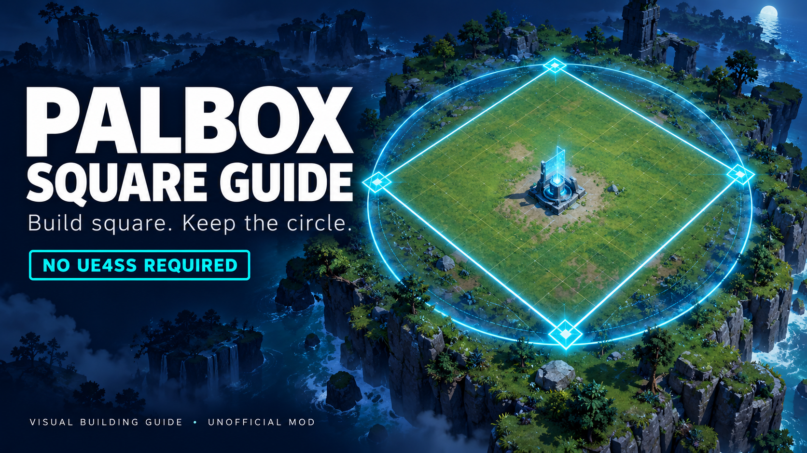
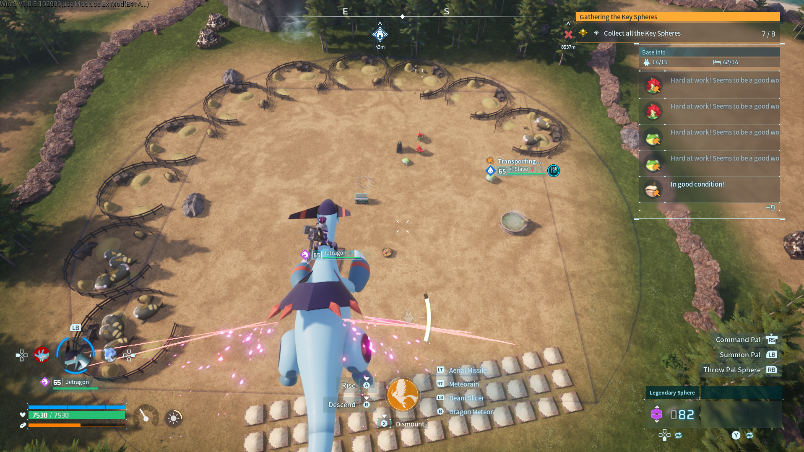

# Palbox Square Guide

**Build square. Keep the circle.** A visual building guide for Palworld that adds a fixed blue square inside the existing Palbox boundary.



*AI-generated promotional illustration. The illustration's decorative grid is not an in-game feature. See the actual gameplay screenshot below.*

**[Download version 1.0.0](https://github.com/Karthus3560/palworld-square-guide/releases/latest)** · **[Report an issue](https://github.com/Karthus3560/palworld-square-guide/issues)**

## What it does

- Adds a square centered on the Palbox and fixed to its orientation.
- Reuses Palworld's original blue boundary materials.
- Keeps the circular boundary visible alongside the square.
- Inherits the original boundary's visibility and scale.
- Provides a guide for laying out rectangular buildings within the circle.

The square's corners meet the circle. Its side length is `radius × √2`: about **49.5 metres** with the standard 35-metre radius. Allow space for building overhangs when laying out foundations.

This is a visual guide. It does not change base territory, building permissions, worker range, pathfinding, decay rules, or save data. It adds no snapping, foundation grid, or rotation controls.

## Actual gameplay



*Unedited screenshot supplied by the tester, who confirmed the mod works. The other structures, terrain appearance, HUD and installed mods shown are not supplied by this mod.*

## Requirements and tested version

- Palworld on Windows PC with support for PAK mods.
- Confirmed working by the tester on **Steam v1.0.5.102999**, build **25246127**.
- **No UE4SS, Lua, trainer, DLL loader, or other mod is required.**

Other game builds, Game Pass, dedicated-server deployment, and multiplayer combinations have not been separately verified. This is a local visual patch; it does not add server-side gameplay functionality.

## Install

1. Close Palworld.
2. Download and extract `PalboxSquareGuide-1.0.0.zip` from Releases.
3. Open the game's installation directory. On Steam: **Palworld → Properties → Installed Files → Browse**.
4. Copy the extracted **Pal** folder into the Palworld installation directory, merging folders when prompted.
5. Confirm this final path:

   ```text
   Palworld/Pal/Content/Paks/~mods/PalboxSquareGuide_P.pak
   ```

6. Launch normally and visit a base. There is no trainer to launch and no hotkey to press. The guide follows the normal boundary's visibility conditions.

Manual installation is the verified method; no mod-manager installer is supplied. If installing the PAK directly, create `~mods` if necessary.

## Radius expansion compatibility

The square is attached to the original `AreaRange` and `AreaRange1` visual components. A mod that scales those components also scales the square.

A mod that changes only the functional base radius will not resize the guide. The guide follows the **visible circle**, which may differ from the functional area when an expansion mod does not synchronize them. It cannot fix worker or navigation problems introduced by an expansion mod. No named expansion mod has been specifically certified.

## Conflicts and updates

This PAK replaces the Palbox blueprint:

```text
/Game/Pal/Blueprint/MapObject/BuildObject/BP_BuildObject_PalBoxV2
```

Other PAK mods replacing the same blueprint can conflict. Radius mods that only adjust component scale at runtime are a different mechanism, but still need testing together. Game updates that change this blueprint may require a new release.

## Uninstall or update

Close the game and remove only `PalboxSquareGuide_P.pak` from `~mods`. The original game archive is not edited. To update, replace that file with the new version while the game is closed; do not keep multiple versions installed.

## Troubleshooting and reports

- **No guide:** check the exact installation path, restart the game, and check under the same conditions that show the normal circle.
- **Unexpected appearance or missing circle:** check for another mod replacing the Palbox blueprint.
- **Square does not grow:** verify the expansion mod actually resizes the visible boundary.
- **Problem after a game update:** remove this PAK while awaiting a compatible release.

For an issue report, include game version, storefront, mod version, relevant mod names, reproduction steps, and a screenshot. Remove personal information from any logs before sharing. Please distinguish visual problems from worker behaviour that this mod does not modify.

## Development, credits and media

Designed and gameplay-tested by **Karthus3560**; implemented with OpenAI Codex. Source transformation code and promotional cover were generated with AI. The in-game meshes and blue materials are existing Palworld/Unreal assets referenced by the patch, not AI-generated art. The screenshot is actual user-provided gameplay.

Asset tooling: [UAssetGUI / UAssetAPI](https://github.com/atenfyr/UAssetGUI), [repak](https://github.com/trumank/repak), and [Palworld modding mappings](https://github.com/PalworldModding/UsefulFiles). These are development tools, **not player requirements**, and are not included in the download.

See [build notes](docs/BUILD.md), [validation](docs/VALIDATION.md), and [credits and rights](CREDITS.md). This is an unofficial fan mod, not affiliated with or endorsed by Pocketpair or Epic Games.
